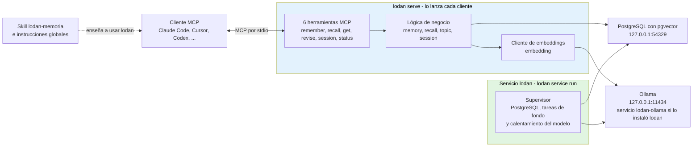

# lodan

Memoria persistente local para asistentes de IA. Guarda decisiones, preferencias, hechos y eventos en una base de datos, recupera lo que importa en una sola consulta, y funciona solo en tu máquina (localhost). Pensado para Linux, macOS y Windows; el estado real de cada sistema está en [Estado del proyecto](#estado-del-proyecto).

## Tabla de contenidos

- [¿Qué es lodan?](#qué-es-lodan)
- [Requisitos previos](#requisitos-previos)
- [Instalación](#instalación)
- [Uso básico](#uso-básico)
- [Comandos CLI](#comandos-cli)
- [Backup y Restauración](#backup-y-restauración)
- [Sincronización entre máquinas](#sincronización-entre-máquinas)
- [Instalación en otro equipo y sincronización](#instalación-en-otro-equipo-y-sincronización)
- [Hooks de los clientes de IA](#hooks-de-los-clientes-de-ia)
- [Documentación técnica](#documentación-técnica)
- [Arquitectura](#arquitectura)
- [Estado del proyecto](#estado-del-proyecto)
- [Estructura del proyecto](#estructura-del-proyecto)
- [Licencia](#licencia)
- [Contribución](#contribución)

## ¿Qué es lodan?

lodan resuelve un problema de contexto: cuando trabajas con varios asistentes de IA (Claude, Cursor, Hermes, otros), cada uno olvida lo que pasó al cerrar la sesión. Información importante — decisiones de proyecto, preferencias personales, hechos que debería recordar — se pierde o hay que repetirla.

lodan mantiene **una sola memoria compartida** en tu máquina. Los asistentes guardan lo que importa mediante la skill `lodan-memoria` y las herramientas MCP de lodan, y recuperan el contexto relevante en una sola consulta. La escala medida llega a 1 millón de registros en una máquina de 8 GB de RAM; a 10 millones no se cumple el objetivo de latencia en esa máquina (ver [Estado del proyecto](#estado-del-proyecto)).

**Características:**
- Búsqueda por significado + búsqueda de texto, combinadas (embeddings + reordenación con el vector completo).
- Búsqueda en la base de datos con p95 de 66,9 ms a 1 millón de registros (400 candidatos, máquina de 8 GB). El cálculo del embedding de la consulta es un coste fijo aparte, que no depende del número de registros.
- Funciona solo en localhost: privado, sin red, seguro.
- Instalación con un solo comando (`lodan install`) en Linux, macOS y Windows. Plataformas objetivo según el PRD: Windows x64, Linux x64/ARM64 y macOS Intel/Apple Silicon.
- Configura automáticamente los clientes MCP que detecta en tu equipo: Claude Code, Claude Desktop (solo macOS y Windows), Cursor, Codex, Gemini CLI, Windsurf, VS Code, Hermes, opencode, Zed y LM Studio. Cualquier otro cliente MCP puede usar lodan configurándolo a mano (`lodan serve` por stdio, o HTTP local con `lodan serve --http`).

---

## Requisitos previos

Para compilar y ejecutar lodan solo necesitas:

- **Go** ≥ 1.25.0 (mínimo de `go.mod`). `go.mod` fija además `toolchain go1.27.1`: con `GOTOOLCHAIN=auto` (valor por defecto) Go la descarga sola.
- Conexión a internet durante `lodan install`, que descarga lo que falte (ver abajo).

PostgreSQL y Ollama **no** son requisitos previos: los aporta `lodan install`.

- **PostgreSQL ≥ 16 con pgvector ≥ 0.7.0:** `lodan install` los descarga con micromamba (desde conda-forge, comprobando su SHA-256) a la carpeta de datos de lodan, sin tocar el PostgreSQL del sistema.
- **Ollama** (calcula los embeddings): si ya hay uno respondiendo en la URL configurada, `lodan install` lo reutiliza. Si no, pide confirmación y descarga el suyo (unos 1,5 GB; unos 160 MB en macOS) y lo registra como servicio `lodan-ollama`. No lo descarga con `--skip-ollama` ni con `--skip-service`. Sin embeddings, lodan sigue guardando (el embedding queda pendiente) y busca solo por texto.
- Para los tests: los que necesitan base de datos arrancan un PostgreSQL temporal y requieren binarios de PostgreSQL ≥ 16 con pgvector ≥ 0.7.0 (`pg_config` en el `PATH` o `LODAN_PG_BIN_DIR`); si no los hay, se saltan con aviso.

No se necesita ninguna herramienta de generación de código ni `Makefile`: se compila con `go build`.

---

## Instalación

El flujo es el mismo en los tres sistemas: compila con Go y ejecuta `lodan install`. Desde la raíz del repositorio:

### Linux

```bash
go build ./cmd/lodan

# Instalar (pide sudo solo para registrar los servicios)
./lodan install

# Verificar la instalación
./lodan doctor
```

### macOS

```bash
go build ./cmd/lodan

# Instalar (pide sudo solo para registrar los servicios)
./lodan install

# Verificar la instalación
./lodan doctor
```

macOS está compilado y probado solo en unidad: no se ha instalado de verdad en un Mac (ver [Estado del proyecto](#estado-del-proyecto)).

### Windows

Desde una terminal de Windows (PowerShell), no desde WSL:

```powershell
go build .\cmd\lodan

# Instalar (el paso de los servicios pide administrador con UAC)
.\lodan install

# Verificar la instalación
.\lodan doctor
```

Notas de Windows, verificadas en la prueba real:
- Instala y desinstala desde una terminal de Windows. Lanzado desde WSL, el UAC se cancela sin mostrarse.
- Si instalas lodan a la vez en WSL y en Windows, ambos usan `127.0.0.1:54329` (PostgreSQL) y `127.0.0.1:11434` (Ollama), y el relé de localhost de WSL hace que el que arranca primero se quede el puerto.

### Qué hace `lodan install`

Ocho pasos, en este orden. Los tres primeros son críticos (si uno falla, la instalación se detiene); el resto informa del fallo y continúa. Es idempotente: repetirlo no duplica nada.

1. **Binario estable:** copia el ejecutable a `<datos>/bin/lodan` (`lodan.exe` en Windows) y, en Linux y macOS, crea el enlace `~/.local/bin/lodan` si esa carpeta existe y no hay otro archivo con ese nombre.
2. **PostgreSQL y pgvector:** los descarga con micromamba a `<datos>/runtime` y guarda su ruta en `config.json`.
3. **Base de datos:** inicializa el clúster, crea la base `lodan` y aplica las migraciones.
4. **Ollama:** reutiliza el que responda o descarga el de lodan (con confirmación).
5. **Servicios del sistema:** registra y arranca el servicio `lodan` (`lodan service run`) y, si instaló Ollama, `lodan-ollama`. Es el único paso que pide permisos de administrador (`sudo` en Linux y macOS, UAC en Windows). Los gestores son systemd (Linux), LaunchDaemon (macOS) y el SCM (Windows).
6. **Modelo de embeddings:** descarga en Ollama el modelo configurado (por defecto `embeddinggemma:300m-qat-q4_0`) si falta.
7. **Clientes MCP:** añade la entrada `lodan` a los clientes que detecta (solo si existe la carpeta de su aplicación; Claude Code se detecta por `~/.claude.json` o por el CLI `claude`), tras pedir confirmación y guardando una copia `.bak-lodan` del archivo.
8. **Skill e instrucciones:** copia la skill `lodan-memoria` a `~/.claude/skills` (y a `~/.gemini/config/skills` si existe) y añade un bloque de instrucciones a `~/.claude/CLAUDE.md`, `~/.codex/AGENTS.md` y `~/.gemini/GEMINI.md` según qué clientes haya.

Al terminar, reinicia tus clientes de IA para que carguen el servidor lodan.

Opciones de `lodan install`:

| Opción | Efecto |
| :--- | :--- |
| `--yes` | Responde sí a todas las confirmaciones |
| `--dry-run` | Muestra lo que haría, sin escribir, descargar ni pedir administrador |
| `--skip-ollama` | No instala Ollama si no hay ninguno |
| `--skip-service` | No registra los servicios; PostgreSQL arrancará bajo demanda cuando un cliente lance `lodan serve` |
| `--skip-clients` | No toca la configuración de los clientes MCP |
| `--only <cliente>` | Configura solo ese cliente (repetible). Identificadores: `claude-code`, `claude-desktop`, `cursor`, `codex`, `gemini`, `windsurf`, `vscode`, `hermes`, `opencode`, `zed`, `lmstudio` |

Windsurf y LM Studio solo se configuran si su archivo de configuración ya existe (sus rutas no están verificadas).

### Dónde guarda lodan sus datos

| Sistema | Carpeta de datos (por defecto) |
| :--- | :--- |
| Linux | `$XDG_DATA_HOME/lodan`, o `~/.local/share/lodan` si `XDG_DATA_HOME` está vacía |
| macOS | `~/Library/Application Support/lodan` |
| Windows | `%LOCALAPPDATA%\lodan` |

Se puede cambiar con la variable `LODAN_DATA_DIR`.

### Desinstalar

```bash
./lodan uninstall            # quita clientes, skill, servicios y binario; conserva los datos
./lodan uninstall --purge    # borra además todos los datos (pide escribir «borrar»)
./lodan uninstall --dry-run  # muestra lo que haría, sin cambiar nada
```

`--yes` responde sí a las confirmaciones, salvo la de `--purge`, que siempre pide escribir «borrar». La desinstalación con servicios registrados también necesita permisos de administrador.

---

## Uso básico

Tras instalar y reiniciar tus clientes de IA, no hay que arrancar nada a mano: el servicio `lodan` mantiene PostgreSQL y las tareas de fondo, y cada cliente MCP lanza `lodan serve` por su cuenta (transporte stdio, que es el valor por defecto). Si instalaste con `--skip-service`, `lodan serve` arranca PostgreSQL bajo demanda.

**Muchas IAs a la vez.** Cada cliente MCP lanza su propio `lodan serve`, con un pool de hasta 4 conexiones. El PostgreSQL de lodan admite 100 conexiones (`max_connections = 100`), y un `lodan serve` inactivo devuelve sus conexiones a los 30 segundos, así que caben al menos 25 IAs usando la memoria a pleno a la vez (100 / 4), y en la práctica unas 50, porque cada una suele usar solo 1 o 2 conexiones (prueba del 2026-10-22: 30 de 30 procesos simultáneos sin error; con 60, 51). Los clústeres creados por versiones anteriores (que tenían `max_connections = 20` y se saturaban con unos 5 clientes, con el error `too many clients already`) se actualizan solos al arrancar lodan; el límite nuevo se aplica en el siguiente arranque de PostgreSQL (`lodan service restart`, o `lodan db stop` y `lodan db start` sin servicio). Si has puesto otro valor a mano en el bloque `# lodan` de `postgresql.conf`, lodan lo respeta.

Para comprobar el estado (en Windows, `.\lodan` en lugar de `./lodan`):

```bash
./lodan doctor            # una línea por comprobación, con la solución propuesta si algo falla
./lodan status            # estado de la base de datos y de Ollama
./lodan service status    # estado del servicio lodan
```

### Qué le dices a tu IA y qué herramienta usa

No hay comandos de terminal para guardar o recuperar: tú hablas en lenguaje natural con tu asistente y es él quien usa las herramientas MCP de lodan, guiado por la skill `lodan-memoria` y por las instrucciones del propio servidor.

| Tú dices | La IA usa |
| :--- | :--- |
| «Entreno por la tarde» o «hemos decidido usar Postgres» | `remember`: guarda un registro con título, contenido, tipo y etiquetas (exige al menos una concreta como `#coche-4860ngl` o `#proyecto-agm`). Acepta `force: true` para guardar casi duplicados |
| «Antes de guardarlo, revísalo» | `remember` con `preview: true`: corre todas las comprobaciones sin guardar nada (etiquetas, duplicado, clave, alias, conectados, `revisa:`) |
| «Recuérdame qué decidimos sobre la base de datos» | `recall`: recupera la ficha del tema, los últimos eventos, los resultados y lo conectado por etiquetas |
| «¿De qué hablamos la última vez?» | `session` con `action: last` |
| «Esa decisión ya no vale» | `revise` con `action: invalidate` (o `supersede` si la sustituye otra) |
| «AGM y Agridemur son lo mismo» | `revise` con `action: alias` y `tag`+`with_tag`: el servidor lo aplica solo a partir de ahora |
| «Esos dos coches no son el mismo» | `revise` con `action: reject_alias` |
| «Esto es un duplicado, junta los dos» | `revise` con `action: merge`: primero vista previa (sin `confirm`), luego `confirm: true` con la huella que devolvió la vista previa |
| (al terminar la conversación) | `session` con `action: end` y un resumen breve |
| «¿Está funcionando lodan?» | `status` |

### Acceso por HTTP local (opcional)

Por defecto `lodan serve` habla MCP por stdio. Con `--http` escucha en HTTP (MCP streamable) y solo acepta direcciones `127.0.0.1` o `localhost`:

```bash
./lodan serve --http                      # usa la dirección de la configuración (por defecto 127.0.0.1:7438)
./lodan serve --http --addr 127.0.0.1:7438
```

### Configuración

lodan lee `config.json` de la carpeta de datos; las variables de entorno `LODAN_*` tienen prioridad sobre él. Valores por defecto:

| Ajuste | Por defecto | Variable de entorno |
| :--- | :--- | :--- |
| Puerto de PostgreSQL | `54329` | `LODAN_PG_PORT` |
| URL de Ollama | `http://127.0.0.1:11434` | `LODAN_OLLAMA_URL` |
| Modelo de embeddings | `embeddinggemma:300m-qat-q4_0` (768 dimensiones) | `LODAN_EMBED_MODEL`, `LODAN_EMBED_DIMS` |
| Dirección HTTP de `serve --http` | `127.0.0.1:7438` | `LODAN_HTTP_ADDR` |
| Tope de una respuesta de `recall` | 6000 bytes | `LODAN_RECALL_MAX_BYTES` |
| Minutos de inactividad que cierran una sesión | 30 | `LODAN_SESSION_IDLE_MINUTES` |
| Minutos entre sincronizaciones de la tarea de `lodan sync schedule` (`sync_interval_minutes`; 0 = sin tarea) | 0 | `LODAN_SYNC_INTERVAL_MINUTES` |

El resto de ajustes (carpeta de binarios de PostgreSQL, umbrales de duplicados y de temas, tiempos del embedding) están en [`internal/config/config.go`](internal/config/config.go).

---

## Comandos CLI

Todos los subcomandos aceptan `-h` para mostrar sus opciones (`lodan <subcomando> -h`).

| Comando | Descripción | Ejemplo |
| :--- | :--- | :--- |
| `serve` | Arranca el servidor MCP: stdio por defecto, `--http` (con `--addr`) para HTTP local | `./lodan serve` |
| `db` | Gestiona el PostgreSQL local: `init`, `start`, `stop`, `status`, `backup`, `restore`, `fix-encoding` | `./lodan db status` |
| `migrate` | Aplica las migraciones pendientes (sin subcomandos) | `./lodan migrate` |
| `status` | Muestra el estado de la base de datos y de Ollama | `./lodan status` |
| `install` | Instala lodan: PostgreSQL, Ollama, servicio de sistema, clientes MCP y skill. Opciones: `--yes`, `--dry-run`, `--skip-ollama`, `--skip-service`, `--skip-clients`, `--only <cliente>` | `./lodan install --dry-run` |
| `doctor` | Diagnostica la instalación, con una línea por comprobación | `./lodan doctor` |
| `uninstall` | Desinstala lodan; los datos se conservan salvo con `--purge`. Opciones: `--yes`, `--dry-run`, `--purge` | `./lodan uninstall --purge` |
| `service` | Gestiona el servicio de sistema: `start`, `stop`, `restart`, `enable`, `disable`, `status` (cada uno con `--name`, por defecto `lodan`) | `./lodan service status` |
| `sync` | Sincroniza la memoria con otras máquinas por git, cifrada: `init --repo <url> [--key <fichero>] [--machine <id>]`, `push`, `pull`, `run`, `schedule [--every <minutos>]`, `unschedule` | `./lodan sync pull` |
| `hook` | Hooks de los clientes de IA: `compact`, `subagent-stop` (con `--client <nombre>`; leen el evento por la entrada estándar y siempre salen con 0) | `./lodan hook compact --client claude-code` |
| `bench` | Ejecuta el benchmark sobre la base `lodan_bench`. Opciones: `--rows`, `--candidates`, `--reuse`, `--queries`, `--out`, `--seed`, `--embed-queries` | `./lodan bench --rows 10000,100000` |

Notas:
- `bench` mide por defecto 10.000, 100.000 y 1.000.000 de filas y escribe el informe en `specs/001-nucleo-memoria/benchmark.md` (opción `--out`).
- `service` tiene además la acción `run` (el proceso que mantiene vivo el gestor de servicios) y las acciones internas `install` y `uninstall`, que ejecuta `lodan install` con permisos elevados; no hace falta llamarlas a mano.
- `service start`, `stop`, `restart`, `enable` y `disable` suelen necesitar `sudo` (Linux y macOS) o una consola de administrador (Windows). En Windows, `service status` funciona sin elevar. En Windows, `lodan-ollama` se gestiona con `lodan service restart --name lodan-ollama`.
- `db backup` y `db restore` se describen en la siguiente sección.

---

## Backup y Restauración

lodan permite crear backups de la base de datos con tres estrategias: **full** (copia completa), **differential** (cambios desde el último full) e **incremental** (cambios desde el último backup de cualquier tipo). Los backups se almacenan como archivos `.tar.zst` (tar comprimido con zstd).

### Tipos de backup

- **Full (`--full`):** Copia completa de todos los datos. Base para backups posteriores. Defecto si no especificas nada.
- **Differential (`--differential`):** Copia solo los archivos modificados desde el último backup **full** del destino. Opción intermedia en tamaño y velocidad.
- **Incremental (`--incremental`):** Copia solo los archivos modificados desde el último backup **de cualquier tipo** (full, incremental o differential) del destino. Es el más rápido y compacto.

Differential e incremental necesitan un backup full previo en el destino; sin él fallan con un error claro.

### Ejemplos de uso

#### Crear backups

```bash
# Full backup (por defecto)
./lodan db backup --to /backups

# Differential (requiere un full previo)
./lodan db backup --to /backups --differential

# Incremental (requiere un full previo)
./lodan db backup --to /backups --incremental
```

Los archivos se guardan con nombre: `lodan_backup_YYYY-MM-DD_HHMMSS.{full|diff|incr}.tar.zst`

#### Restaurar desde un archivo específico

```bash
# Restaurar desde un backup específico (full)
./lodan db restore --from /backups/lodan_backup_2026-10-01_120000.full.tar.zst
```

#### Restauración automática

```bash
# Auto-detecta el backup más reciente y restaura (full → incremental/differential)
./lodan db restore --from /backups
```

Cuando restauras desde un directorio sin especificar archivo, lodan ordena los backups por fecha (RFC3339Nano en `info.txt`), elige el full más reciente y aplica los incrementales/diferenciales posteriores de forma secuencial.

Cada backup incluye un manifiesto (`manifest.txt`) con la lista completa de lo que contenía el clúster en ese momento. Al restaurar, lodan extrae toda la cadena a un directorio temporal, borra de él lo que el manifiesto del último backup no lista (archivos eliminados desde el full) y comprueba que no falta nada ni cambia de tipo o tamaño. Si algo no cuadra, aborta sin tocar el clúster actual.

### Advertencia de downtime

**Durante un backup, el servidor se detiene solo mientras se copian los datos a un directorio temporal dentro del destino** (`.lodan_backup_<fecha>.<tipo>.staging`, que se borra siempre al terminar). La parada dura lo que tarda esa copia sin comprimir; la compresión zstd se hace después, con PostgreSQL ya en marcha. Por eso el destino necesita espacio libre para una copia sin comprimir de lo que se respalda. Durante la parada, y durante una restauración, los clientes MCP no pueden conectar. Planifica backups en momentos de baja actividad si es crítico.

### Coordinación con el servicio

Con el servicio `lodan` en marcha no hace falta pararlo antes de un backup o una restauración: el supervisor pausa y reanuda PostgreSQL solo. En la prueba de extremo a extremo en Linux (clúster de 42 MB) la pausa fue de ~1 s. Sin servicio en marcha, `lodan db backup` y `lodan db restore` paran y arrancan PostgreSQL ellos mismos.

### Windows: ejecuta el backup como administrador

En Windows el PostgreSQL del servicio corre bajo la cuenta LocalSystem. Un `lodan db backup` lanzado sin elevar con el servicio en marcha no puede pararlo y falla: ejecútalo en una consola de administrador. Esta combinación (backup con el servicio en Windows, como administrador) todavía está pendiente de probar; ver [Estado del proyecto](#estado-del-proyecto).

### Retención de backups

La gestión automática de retención (eliminar backups antiguos) se implementará mediante un script bash en futuro. Por ahora, mantén el directorio de backups manualmente.

### Reparación de codificación (`lodan db fix-encoding`)

Detecta y repara texto con mojibake (caracteres mal codificados originados al leer UTF-8 como Windows-1252 y volver a guardarlo, como `Albarán` → `Albarán`).

```bash
./lodan db fix-encoding            # Simulación: lista los registros afectados sin modificar nada
./lodan db fix-encoding --apply    # Aplica las reparaciones y recalcula content_hash, tsv y updated_at
```

---

## Sincronización entre máquinas

`lodan sync` lleva la memoria de una máquina a las demás a través de un repositorio git privado, sin perder ni duplicar nada. Cada máquina escribe solo en su carpeta `changes/<máquina>/` del repositorio, así que git nunca tiene que fusionar un fichero.

- **Qué viaja**: registros, relaciones, sesiones, alias del diccionario (confirmados y rechazados; las sugerencias se quedan locales) y borrados creados o cambiados desde el último envío, en un fichero por envío (`changes/<máquina>/<fecha UTC>-<n>.jsonl.age`). Cada registro viaja con un identificador global (`sync_id`); los ids locales (`#123`) no salen de la máquina y pueden ser distintos en cada una. Las líneas de relación llevan el veredicto y la confianza (`verdict`, `confidence`) cuando están aplicados o pendientes. Los alias son last-write-wins por `updated_at`: el más reciente gana; cuando entra un alias `confirmed` reetiqueta los records locales que tenían la etiqueta original.
- **Qué no viaja**: los embeddings (cada máquina los recalcula), `config.json`, `secret`, la clave y las sugerencias de alias.
- **Formato**: los ficheros sin líneas de alias usan el formato `lodan-sync/1`; los que llevan al menos un alias usan `lodan-sync/2`. El reader acepta ambos.
- **Cifrado**: los ficheros se cifran con [age](https://age-encryption.org) (X25519, librería `filippo.io/age`). En el repositorio solo hay contenido ilegible.

### Reglas de fusión

| Caso | Resultado en todas las máquinas |
| :--- | :--- |
| Registro nuevo | Se crea igual, con sus temas, sesión y fechas |
| Sustituido o invalidado en una máquina | Queda sustituido o invalidado también en las demás; nunca se reactiva |
| Editado en una máquina sobre la versión de la otra | La edición sustituye a la versión anterior |
| Editado en las dos sin haber visto la otra edición | Gana la edición más reciente; la otra queda como versión sustituida (historial) |
| Dos registros vigentes con la misma `key` | Los dos siguen vigentes, la clave se la queda el más reciente, se relacionan como `contradicts` y `lodan sync pull` te pide que decidas cuál vale |
| El mismo contenido creado en las dos | Queda un solo registro |
| Borrado en una máquina | Se borra en todas; el borrado gana a cualquier edición |

### Primera máquina

```bash
lodan sync init --repo git@github.com:<usuario>/lodan-sync.git
lodan sync push
```

`init` clona el repositorio en `<datos>/sync-repo`, crea la clave si no existe (nunca la sobrescribe) y guarda `sync_repo`, `sync_machine` y `sync_key_file` en `config.json`. La clave se guarda por defecto en la carpeta de configuración del usuario (`%APPDATA%\lodan\sync.key` en Windows, `~/.config/lodan/sync.key` en Linux), fuera de la carpeta de datos, para que los backups de lodan no la lleven. git usa tu configuración y tus credenciales de siempre: lodan no guarda ninguna.

### La clave

> **Guarda una copia de la clave fuera del equipo** (por ejemplo, en tu gestor de contraseñas). Sin ella, el contenido del repositorio no se puede recuperar: nadie, tampoco lodan, puede descifrarlo.

El fichero de la clave tiene una línea `AGE-SECRET-KEY-1…`. Para otra máquina, copia el fichero entero por un canal privado (gestor de contraseñas, USB), nunca por el repositorio.

### Segunda máquina

1. Instala lodan (`lodan install`).
2. Copia la clave a la ruta por defecto de esa máquina (o indica otra con `--key`).
3. Ejecuta:

```bash
lodan sync init --repo git@github.com:<usuario>/lodan-sync.git
lodan sync pull
lodan sync push
```

### Uso diario y sincronización automática

- `lodan sync push`: envía los cambios locales.
- `lodan sync pull`: trae e importa los cambios de las otras máquinas y muestra las contradicciones que tienes que resolver.
- `lodan sync run`: `push` y después `pull`.
- `lodan sync schedule [--every 15]`: crea una tarea **de tu usuario** que ejecuta `lodan sync run` cada 15 minutos (de 5 a 1440) con tus credenciales de git, y guarda el intervalo en `sync_interval_minutes`. En Windows es la tarea `lodan-sync` del Programador de tareas (solo con la sesión iniciada, sin administrador, sin ventana gracias a `conhost.exe --headless`); en Linux, el timer `lodan-sync.timer` de `systemd --user`; en macOS, el LaunchAgent `com.lodan.sync`. `lodan sync unschedule` la quita. Lo que imprimen `push`, `pull` y `run` (también la tarea y el pull de inicio de sesión, que no tienen consola) se guarda en `<datos>/logs/sync.log`. No la hace el servicio de lodan porque corre con otra cuenta (LocalSystem o root), que no tiene tus credenciales de git.
- Además, al empezar cada sesión de IA el hook `lodan hook session-start` hace un `pull` (ver [Hooks](#hooks-de-los-clientes-de-ia)).

---

## Hooks de los clientes de IA

Automatismos que no dependen de la disciplina de la IA. Los ejecuta el cliente en eventos de su ciclo de vida; leen el JSON del evento por la entrada estándar, nunca arrancan PostgreSQL y siempre salen con código 0, así que si lodan no está disponible la IA sigue sin más.

| Comando | Evento | Qué hace |
| :--- | :--- | :--- |
| `lodan hook compact --client <nombre>` | Justo después de compactar el contexto | Escribe las instrucciones de recuperación (llamar a `recall` en lote con los temas en curso) y el resumen de la última sesión de lodan de ese cliente |
| `lodan hook compact --client <nombre>` | `PostCompact` (con `compact_summary`) | Guarda el resumen de la compactación en la sesión abierta del cliente, sin cerrarla |
| `lodan hook session-start --client <nombre>` | Al empezar una sesión | Si la sincronización está configurada, trae los cambios de las otras máquinas (`lodan sync pull`) |
| `lodan hook subagent-stop --client <nombre>` | Fin de un subagente | Guarda cada punto del bloque `## Key Learnings` de su informe (máximo 5) como `note` en el tema del proyecto (la carpeta raíz del repositorio git). Descarta lo que parezca un secreto o un DNI/NIE |

`--client` debe ser el nombre con el que el cliente se presenta por MCP (`claude-code`, `opencode`, `antigravity-client`), para que el resumen sea el de sus sesiones.

`lodan install` los registra en cada cliente instalado, sin tocar los hooks que ya tengas (y `lodan uninstall` los quita; `lodan doctor` comprueba que están):

| Cliente | Dónde | Qué se registra | Qué no se puede |
| :--- | :--- | :--- | :--- |
| Claude Code | `~/.claude/settings.json` | `SessionStart` (matcher `startup\|resume\|clear`) → `hook session-start`; `SessionStart` (matcher `compact`) y `PostCompact` → `hook compact`; `SubagentStop` y `PostToolUse` sobre `SubagentHandback` → `hook subagent-stop` | — |
| opencode 2.x | `~/.config/opencode/plugins/lodan.js` | Plugin v2: al crear una sesión hace `hook session-start`; al terminar una compactación guarda el resumen e inyecta las instrucciones; al terminar un subagente (herramienta `subagent`, también en segundo plano) guarda sus Key Learnings | Si el proveedor compacta por su cuenta (compactación nativa), no hay resumen que guardar |
| Antigravity | `~/.gemini/config/hooks.json` (grupo `lodan`) | `SessionStart` → `hook compact --format antigravity` (al empezar una conversación inyecta las instrucciones y el resumen de la última sesión) y `hook session-start --format antigravity` (pull) | Antigravity no tiene evento de compactación ni de fin de subagente: no se simulan |

---

## Documentación técnica

La documentación técnica completa está en [`specs/PRD.md`](specs/PRD.md):
- Problema y contexto (por qué lodan existe)
- Objetivos y métricas de éxito
- Alcance (qué está incluido y qué no)
- Arquitectura de base de datos y búsqueda
- Especificaciones por funcionalidad (en `specs/NNN-*/`)

También ver [`CODEBASE.md`](CODEBASE.md) para el stack con sus versiones y el estado actual de cada módulo.

### Herramientas MCP

lodan expone **máximo 6 herramientas** vía MCP (stdio o HTTP streamable):

1. **`remember`** — Guarda registros (dato, preferencia, decisión, evento o nota) con etiquetas (`tags`/`topics`, juntas, máx. 8: al menos una concreta de las 12 familias como `#proyecto-agm` o `#coche-4860ngl`, más 1-3 generales como `#agridemur`). Exige al menos una etiqueta concreta por ítem (`item N no guardado: falta una etiqueta concreta (...)`). Detecta y repara mojibake automáticamente (`texto reparado (codificación)`). Bloquea casi duplicados (similitud ≥ 0.90 con sugerencia de actualización o `force: true` para forzar el guardado) y avisa con `¿duplicado?` para similitudes entre 0.75 y 0.90 con etiquetas compartidas. Deduplica por hash exacto, resuelve etiquetas y alias confirmados, crea relaciones pedidas con `relate` y lista candidatos con `revisa:`. Con `preview: true`, corre todas las comprobaciones sin guardar nada. Con `WithEmbeddings` activo en el servidor, añade la nota de embeddings pendientes; en la edición lite se omite.
2. **`recall`** — Recupera lo relevante para una o varias preguntas (`queries`) en lenguaje natural: ficha del tema, últimos eventos y resultados, en un bloque por pregunta; al final, los registros conectados por las etiquetas concretas del primer resultado (ranking por rareza: `Σ ln(N/n)`, umbral `tag_link_strength` por defecto 3.0). Admite filtros (`tags_all`, `tags_any`, `date_from`, `date_to`) y `mode` (`"rank"` por defecto o `"list"` para ordenar por fecha descendente sin ficha).
3. **`get`** — Devuelve el contenido completo, las etiquetas, la clave y las relaciones de registros concretos por id.
4. **`revise`** — Cambia uno o varios registros (`ops`): `update`, `supersede`, `invalidate`, `delete` (definitivo, con `confirm`); gestiona relaciones (`relate`, `confirm_relation`, `reject_relation`); aplica alias (`alias`, `reject_alias`); guarda veredictos sobre conflictos con su confianza (`verdict`: `contradice`/`sustituye`/`compatible`/`no_relacionado`; ≥ 0.7 aplica, < 0.7 queda pendiente); o junta ≥ 2 registros en uno nuevo (`merge`, siempre con vista previa antes de `confirm: true` y `fingerprint`).
5. **`session`** — Consulta o cierra conversaciones, una o varias operaciones (`ops`): `last` (la última; filtrable por tema, cliente o fecha), `list` y `end` (cierra la actual con un resumen).
6. **`status`** — Estado de la memoria: base de datos, registros, embeddings pendientes, temas, sesiones, Ollama, alias confirmados y pendientes, veredictos pendientes y contradicciones abiertas.

Todas las herramientas que reciben operaciones aceptan lotes, con un mismo tope de seguridad de 200 por llamada; un lote de `recall` calcula los embeddings de golpe y resuelve las búsquedas en paralelo. `recall`, `get` y `status` se declaran de solo lectura (`readOnlyHint`) para que los clientes puedan lanzarlas a la vez. Cada respuesta es texto compacto (sin JSON verboso), con tope de tamaño, y optimizada para tokens. Los parámetros de cada herramienta están en [`skills/lodan-memoria/references/herramientas.md`](skills/lodan-memoria/references/herramientas.md).

### Búsqueda

lodan combina dos estrategias de búsqueda:

- **Por significado (embeddings):** Ollama calcula el embedding de la consulta (vectores `halfvec` de 768 dimensiones). pgvector busca primero candidatos con un índice HNSW sobre la cuantización binaria de los vectores y los reordena con el vector completo por similitud de coseno.
- **Por texto:** búsqueda de texto completo de PostgreSQL con la configuración `lodan_es` (indiferente a tildes y mayúsculas/minúsculas mediante `unaccent`), útil para nombres, matrículas o comandos exactos. Si la búsqueda con todas las palabras no arroja resultados, aplica fallback con coincidencia por alguna de las palabras (mostrando el aviso `(sin coincidencia con todas las palabras: resultados con alguna de ellas)`); si tampoco encuentra nada, aplica búsqueda aproximada por trigramas con `pg_trgm` para tolerar erratas (mostrando el aviso `(sin coincidencia exacta: resultados parecidos)`). En modo `list`, los registros se devuelven ordenados por fecha (`occurred_at DESC, id DESC`).

La reordenación combina ambos resultados y devuelve los primeros. Latencias medidas en [Estado del proyecto](#estado-del-proyecto).

---

## Arquitectura



**Flujo:**
1. El cliente de IA (Claude, Cursor, etc.) arranca `lodan serve` y habla con él por MCP (stdio; con `--http`, por HTTP en `127.0.0.1:7438`). La skill `lodan-memoria` y las instrucciones del servidor le enseñan qué guardar y cuándo recuperar.
2. El servidor procesa `remember`, `recall`, `revise`, etc.
3. La búsqueda consulta PostgreSQL (texto + embeddings vía pgvector) y Ollama (cálculo del embedding de la consulta).
4. Respuesta compacta de vuelta al cliente.
5. En paralelo, el servicio `lodan` (`lodan service run`) mantiene PostgreSQL en marcha, completa los embeddings pendientes, cierra las sesiones inactivas y precarga el modelo en Ollama. Si el servicio no está, `lodan serve` arranca PostgreSQL por su cuenta.

---

## Estado del proyecto

Todo lo de esta sección sale de los informes de verificación de cada especificación. Máquina de referencia: i5-4590, 4 núcleos, 8 GB de RAM, sin GPU dedicada para el cálculo.

### Plataformas

Fuente: [`specs/002-instalador/verificacion.md`](specs/002-instalador/verificacion.md).

| Sistema | Estado |
| :--- | :--- |
| Linux | Instalación real como servicio systemd, gestionado con `systemctl` y `lodan service` |
| Windows 11 | Probada de verdad: instalación con UAC desde una terminal de Windows, servicios `lodan` y `lodan-ollama` en el SCM, `doctor` (12 comprobaciones, 0 errores y 0 avisos) y MCP `remember`/`recall` contra los servicios. **Falta probar:** `lodan service stop/start/restart` como administrador, el backup con el servicio en marcha, el reinicio del equipo y `uninstall --purge` con servicios registrados |
| macOS | Solo compilado y probado en unidad; sin instalación real |

### Rendimiento y escala

Fuente: [`specs/001-nucleo-memoria/benchmark.md`](specs/001-nucleo-memoria/benchmark.md) y [`specs/001-nucleo-memoria/verificacion.md`](specs/001-nucleo-memoria/verificacion.md). Datos sintéticos; con embeddings reales el recall puede diferir.

| Filas | p95 de la búsqueda en la BD (100–400 candidatos) | recall@10 (100–400 candidatos) | Tabla e índices |
| :--- | :--- | :--- | :--- |
| 10.000 | 7,3–13,2 ms | 0,68–0,84 | 33,3 MB |
| 100.000 | 22,3–32,2 ms | 0,999 | 328,5 MB |
| 1.000.000 | 56,6–69,1 ms | 0,46–0,88 | 3.257,7 MB |
| 10.000.000 | 443–1.017 ms | 0,15–0,41 | 32.536,7 MB |

- **Hasta 1 millón de registros** la búsqueda cumple el objetivo de p95 < 300 ms en la máquina de referencia: con 400 candidatos, p95 de 66,9 ms y recall@10 de 0,877.
- **A 10 millones el objetivo O1 (< 300 ms) no se cumple** en esa máquina: la tabla y los índices ocupan 32,5 GB y no caben en 8 GB de RAM. Según el criterio de release del PRD, la versión no se publica hasta que el usuario decida entre aceptar un límite documentado o cambiar el diseño. Está pendiente.
- El embedding de la consulta es un coste fijo aparte: en el benchmark (modelo ya cargado) p50 de 102 ms y p95 de 219 ms; en el uso real del 2026-09-29, p50 de 0,75 s y p95 de 2,7 s.

### Especificaciones

| Especificación | Verificación |
| :--- | :--- |
| 001 · Núcleo de memoria | [`specs/001-nucleo-memoria/verificacion.md`](specs/001-nucleo-memoria/verificacion.md): criterios cumplidos salvo el rendimiento a 10 millones (arriba) |
| 002 · Instalador | [`specs/002-instalador/verificacion.md`](specs/002-instalador/verificacion.md): parcial en servicios (Windows y macOS) y en desinstalación con servicios, como indica la tabla de plataformas. La espera a Ollama ampliada a 3 min no se ha vuelto a probar desde cero |
| 003 · Backup seguro | [`specs/003-backup-seguro/verificacion.md`](specs/003-backup-seguro/verificacion.md): criterios de aceptación cumplidos en Linux, incluida la convivencia con el servicio |
| 004 · Hashtags y calidad (rama `feat/hashtags-calidad`, **pendiente de merge a `dev`**) | Implementada y desplegada en el equipo principal (binario del 2026-10-18). Cubre: 6 herramientas MCP actualizadas (tags y alias en `remember`, alias/verdict/alias-reject en `revise`, `merge` con vista previa y huella de 8 hex); skill `lodan-memoria 3.0.0` (tag families, preview, alias, verdict, merge, key `<etiqueta concreta>/<atributo>`); relación por rareza `Σ ln(N/n)` con umbral `tag_link_strength` configurable; sync con `lodan-sync/2` (aliases y verdicts viajan en el batch file); seed con 2 alias confirmados (`agm → agridemur`, `agm-repo → lodan-memoria`) y 39/39 contradicciones resueltas. Más detalle en [`odd/tasks/hashtags-y-calidad.md`](odd/tasks/hashtags-y-calidad.md) |

---

## Estructura del proyecto

```
lodan/
├── cmd/lodan/              # CLI principal (serve, db, migrate, status, install, doctor, uninstall, service, bench, sync, hook)
├── internal/
│   ├── memory/             # Guardar y revisar registros (remember, get, revise)
│   ├── recall/             # Búsqueda por tema (recall)
│   ├── topic/              # Gestión de etiquetas y temas
│   ├── session/            # Sesiones (seguimiento, cierre, resumen)
│   ├── embedding/          # Cálculo de embeddings (Ollama)
│   ├── mcptools/           # Herramientas MCP y transportes stdio y HTTP
│   ├── benchmark/          # Benchmark reproducible (lodan bench)
│   ├── install/            # Instalador, doctor y desinstalador (clientes MCP, skill, Ollama, PostgreSQL)
│   ├── gitsync/            # Sincronización cifrada entre máquinas por git (lodan sync)
│   ├── hook/               # Hooks de los clientes de IA (lodan hook)
│   ├── service/            # Supervisor del servicio y gestores de servicio por sistema operativo
│   ├── database/           # Clúster de PostgreSQL, pool, migraciones, backup y restauración
│   └── config/             # Configuración (puertos, rutas, variables LODAN_*)
├── skills/                 # Skill lodan-memoria, embebida en el binario
├── specs/
│   ├── PRD.md              # Especificación de producto
│   └── NNN-*/              # Especificaciones por funcionalidad
├── go.mod, go.sum          # Dependencias de Go
├── CODEBASE.md             # Stack con versiones y estado de cada módulo
├── AGENTS.md               # Reglas de desarrollo y skills obligatorias
└── README.md               # Este archivo
```

Tests: están colocados junto al código como `*_test.go` (convención de Go). Los tests que necesitan base de datos arrancan un PostgreSQL temporal. Para desarrollar: `go build ./cmd/lodan`, `go test ./...`, `go vet ./...` y `gofmt -l .` (debe salir vacío).

---

## Licencia

lodan **no tiene licencia formal asignada aún**. El código es privado del usuario (Antonio) y no está distribuido públicamente. Si tienes intención de distribuir lodan o usarlo en un contexto no personal, consulta sobre la licencia.

---

## Contribución

Este es un proyecto personal. Las sugerencias, reportes de bugs y PRs se reciben en el repositorio; ver [`AGENTS.md`](AGENTS.md) para el flujo de desarrollo y las skills obligatorias (`sdd`, `usar-git`, `screaming-architecture`, `lodan-memoria`).

---

## Instalación en otro equipo y sincronización

Para tener lodan en un segundo ordenador con la **misma versión del binario** y la **base de datos sincronizada** por git.

### 0. Prerrequisitos en el equipo nuevo

- **Go ≥ 1.25.0** (con `GOTOOLCHAIN=auto` baja toolchain 1.27.1 sola).
- **git** con acceso por SSH al repo `git@github.com:4ntoniomj/lodan.sync.git` (el mismo repo privado que ya usas; añadir tu clave pública al repo).
- Sin PostgreSQL ni Ollama: `lodan install` los descarga.

### 1. Clonar el repo en una versión exacta

Clona el repo del binario (`lodaan-memory`, NO `lodan.sync`) y haz checkout al commit que quieras usar. Para una versión estable, una **tag** o el HEAD de una rama estable:

```bash
git clone https://github.com/4ntoniomj/lodaan-memory.git
cd lodaan-memory
git checkout <commit o tag>
```

Para tener la última estable de esta fecha:

```bash
git checkout main   # o la rama que Antonio indique tras el merge
```

### 2. Compilar el binario

```bash
go build -o lodan.exe ./cmd/lodan    # Windows
# o
go build -o lodan ./cmd/lodan       # Linux/macOS
```

Verifica el SHA-256 del binario con el del equipo original:

```bash
sha256sum lodan.exe   # Linux/macOS
certutil -hashfile lodan.exe SHA256   # Windows
```

Coincide con el hash del binario instalado en el otro equipo (`C:\Users\4ntoniomj\AppData\Local\lodan\bin\lodan.exe` o el equivalente).

### 3. Instalar lodan en el equipo nuevo

```bash
./lodan install --yes
```

Esto descarga PostgreSQL y Ollama si hace falta, crea el clúster local, aplica las migraciones, registra el servicio `lodan` y configura los clientes MCP que detecte (Claude Code, opencode, Antigravity, etc.). Si ya tenías una instalación previa en esa máquina, `--skip-ollama --skip-service --skip-clients` reutiliza lo que ya estaba al día.

Tras la instalación, verifica:

```bash
./lodan doctor    # 14/14 ok, 0 errores, 0 avisos
./lodan status
```

### 4. Copiar la clave de sync desde el equipo original

La clave de cifrado de los ficheros de sync (X25519 de `age`) **se queda en una sola máquina** y se copia al nuevo equipo por un canal seguro (gestor de contraseñas, USB). **Nunca va al repositorio git**.

En el equipo original:

```bash
lodan doctor    # muestra la ruta: por defecto C:\Users\4ntoniomj\AppData\Roaming\lodan\sync.key (Windows) o ~/.config/lodan/sync.key (Linux)
```

El fichero tiene una sola línea: `AGE-SECRET-KEY-1…`. Cópiala al equipo nuevo en la misma ruta (o usa `--key <ruta>` al inicializar).

### 5. Inicializar el sync en el equipo nuevo

```bash
./lodan sync init --repo git@github.com:4ntoniomj/lodan.sync.git --machine <id-unico>
```

El `--machine` es el identificador de esta máquina en la sincronización (cada máquina escribe en su propia carpeta `changes/<machine>/`). Ejemplos: `pc-portatil`, `servidor-casa`, `oficina`. Tiene que ser distinto al del equipo original.

`init` clona el repo de sync en `<datos>/sync-repo`, guarda la ruta, el id de máquina y la ruta de la clave en `config.json`. Si ya existe la clave en la ruta esperada, la reutiliza.

### 6. Traer los datos del otro equipo

```bash
./lodan sync pull
```

Aplica los ficheros cifrados del otro equipo: crea los registros, alias, relaciones y veredictos que ya tienes. Las contradicciones y registros ya resueltos en el otro equipo **no reaparecen** porque el formato `/2` lleva `verdict` y `confidence` y la re-tiqueta automática de alias funciona out-of-the-box.

### 7. Mandar tus primeros cambios y programar el sync

```bash
./lodan sync push             # envía tus primeros cambios locales al repo
./lodan sync schedule --every 15   # tarea de tu usuario: push+pull cada 15 minutos
```

Con `--every 15` se crea (sin admin):
- **Windows**: tarea programada `lodan-sync` que corre solo con tu sesión iniciada.
- **Linux**: timer `lodan-sync.timer` de `systemd --user`.
- **macOS**: LaunchAgent `com.lodan.sync`.

Logs en `<datos>/logs/sync.log`. La tarea corre con tus credenciales de git (no las del servicio `lodan`, que va con LocalSystem).

### 8. Configurar los hooks de los clientes MCP

Si quieres que los clientes (Claude Code, opencode, Antigravity) también tengan la skill `lodan-memoria 3.0.0` y los hooks:

```bash
./lodan install --only <cliente>    # repetir por cliente
```

O más agresivo (recomendado tras sync inicial):

```bash
./lodan install --yes --skip-ollama --skip-service --skip-postgresql
```

Verifica con `./lodan doctor` que la skill está al día en `~/.claude/skills/lodan-memoria` (o la ruta equivalente del cliente).

### Resumen rápido (TL;DR)

```bash
# En el equipo original:
sha256sum lodan.exe > lodan.exe.sha256    # anota el hash para comparar
lodan sync schedule --every 15            # asegúrate de que el sync sigue corriendo

# En el equipo nuevo:
git clone https://github.com/4ntoniomj/lodaan-memory.git
cd lodaan-memory && git checkout <commit>
go build -o lodan.exe ./cmd/lodan
sha256sum lodan.exe     # debe coincidir con el original
./lodan install --yes
# (copia sync.key desde el original)
./lodan sync init --repo git@github.com:4ntoniomj/lodan.sync.git --machine <id>
./lodan sync pull
./lodan sync push
./lodan sync schedule --every 15
./lodan doctor    # 14/14 ok
```

---

**Última actualización:** 2026-10-18  
**Rama principal:** `dev` (la nueva versión estable `feat/hashtags-calidad` está lista para merge; main no existe en el repo, ver `Estado del proyecto`)
**Repositorio:** https://github.com/4ntoniomj/lodaan-memory  
**Autor:** Antonio (con Claude como orquestador)
