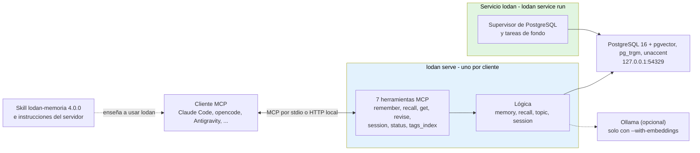

# lodan lite

Memoria persistente local para asistentes de IA. Guarda decisiones, preferencias, datos y eventos en un PostgreSQL de tu máquina, los recupera en una sola consulta y la comparte entre todas tus IAs (Claude Code, opencode, Antigravity, Cursor, Codex…). Esta es la **edición lite**, la versión oficial: no necesita Ollama ni embeddings. Busca por texto completo y por etiquetas concretas.

## Inicio rápido

```bash
go build ./cmd/lodan
./lodan install --skip-ollama   # PostgreSQL, servicio, clientes MCP y skill; sin Ollama
./lodan doctor                  # en lite, el error de «Ollama» es esperado (ver Estado)
```

Reinicia tus clientes de IA y háblales con normalidad: ellos guardan y recuperan con las herramientas MCP de lodan, guiados por la skill `lodan-memoria`. En Windows, usa `.\lodan` desde PowerShell (no desde WSL).

## Tabla de contenidos

- [Qué cambia en lite](#qué-cambia-en-lite)
- [Requisitos](#requisitos)
- [Instalación](#instalación)
- [Uso](#uso)
- [Herramientas MCP](#herramientas-mcp)
- [Búsqueda](#búsqueda)
- [Etiquetas](#etiquetas)
- [Configuración](#configuración)
- [Comandos CLI](#comandos-cli)
- [Backup y restauración](#backup-y-restauración)
- [Sincronización entre máquinas](#sincronización-entre-máquinas)
- [Hooks de los clientes de IA](#hooks-de-los-clientes-de-ia)
- [Arquitectura](#arquitectura)
- [Estado del proyecto](#estado-del-proyecto)
- [Estructura del proyecto](#estructura-del-proyecto)
- [Licencia y contribución](#licencia-y-contribución)

---

## Qué cambia en lite

| Tema | Edición anterior (con Ollama) | lodan lite |
| :--- | :--- | :--- |
| Dependencias | PostgreSQL + pgvector + Ollama con un modelo de embeddings | PostgreSQL + pgvector; Ollama opcional |
| Búsqueda | Embeddings + texto | Texto completo (`unaccent`), coincidencia parcial, trigramas para erratas y etiquetas concretas |
| Embeddings | Siempre activos | Desactivados; se activan con `lodan serve --with-embeddings` o `LODAN_WITH_EMBEDDINGS=true` |
| Herramientas MCP | 6 | 7: se añade `tags_index` |
| Etiquetas | Libres | Cada registro exige al menos una etiqueta concreta de 12 familias |
| Duplicados | Por parecido semántico | Por parecido de texto (trigramas, `pg_trgm`) |
| Nombre visible | `lodan` | `lodan lite` en la CLI, en el saludo MCP y en `status` |

---

## Requisitos

- **Go ≥ 1.25.0** (mínimo de `go.mod`). `go.mod` fija `toolchain go1.27.1`; con `GOTOOLCHAIN=auto` (por defecto) Go la descarga sola.
- **Internet durante `lodan install`**, que descarga PostgreSQL ≥ 16 con pgvector ≥ 0.7.0 mediante micromamba (desde conda-forge, comprobando su SHA-256) a la carpeta de datos de lodan, sin tocar el PostgreSQL del sistema.
- **Ollama: no hace falta.** Si quieres el camino semántico, ver [Configuración](#configuración).
- **Tests**: los que necesitan base de datos arrancan un PostgreSQL temporal y requieren binarios de PostgreSQL ≥ 16 con pgvector (`pg_config` en el `PATH` o `LODAN_PG_BIN_DIR`); si no los hay, se saltan con aviso.

No hay `Makefile` ni generación de código: se compila con `go build`.

---

## Instalación

El flujo es igual en Linux, macOS y Windows: compila y ejecuta `lodan install`.

```bash
go build ./cmd/lodan
./lodan install --skip-ollama   # Linux y macOS piden sudo solo para los servicios; Windows, UAC
./lodan doctor
```

Notas de Windows, verificadas en la prueba real:
- Instala y desinstala desde una terminal de Windows. Lanzado desde WSL, el UAC se cancela sin mostrarse.
- Si instalas lodan en WSL y en Windows a la vez, los dos usan `127.0.0.1:54329` y gana el puerto el que arranca primero.

### Qué hace `lodan install`

Pasos en orden. Los tres primeros son críticos (si uno falla, se detiene); el resto avisa y continúa. Es idempotente.

1. **Binario estable**: copia el ejecutable a `<datos>/bin/lodan` (`lodan.exe` en Windows) y, en Linux y macOS, crea `~/.local/bin/lodan` si esa carpeta existe.
2. **PostgreSQL y pgvector**: los descarga a `<datos>/runtime` y guarda su ruta en `config.json`.
3. **Base de datos**: inicializa el clúster, crea la base `lodan` y aplica las migraciones (`0001`–`0006`).
4. **Ollama**: con `--skip-ollama` no instala ninguno (si ya hay uno respondiendo, lo usa). Sin esa opción, pide confirmación para descargarlo; en lite no aporta nada salvo que actives los embeddings.
5. **Servicios del sistema**: registra y arranca el servicio `lodan` (`lodan service run`). Es el único paso que pide administrador. Gestores: systemd (Linux), LaunchDaemon (macOS) y SCM (Windows).
6. **Modelo de embeddings**: solo si hay Ollama.
7. **Clientes MCP**: añade la entrada `lodan` a los clientes detectados, tras confirmación y guardando una copia `.bak-lodan`.
8. **Skill e instrucciones**: copia la skill `lodan-memoria` (4.0.0) a `~/.claude/skills` (y a `~/.gemini/config/skills` si existe) y añade un bloque de instrucciones a `~/.claude/CLAUDE.md`, `~/.codex/AGENTS.md` y `~/.gemini/GEMINI.md`, según los clientes que haya.

| Opción | Efecto |
| :--- | :--- |
| `--yes` | Responde sí a todas las confirmaciones |
| `--dry-run` | Muestra lo que haría, sin escribir ni descargar |
| `--skip-ollama` | No instala Ollama (recomendado en lite) |
| `--skip-service` | No registra servicios; `lodan serve` arranca PostgreSQL bajo demanda |
| `--skip-clients` | No toca la configuración de los clientes MCP |
| `--only <cliente>` | Configura solo ese cliente (repetible): `claude-code`, `claude-desktop`, `cursor`, `codex`, `gemini`, `windsurf`, `vscode`, `hermes`, `opencode`, `zed`, `lmstudio` |

Windsurf y LM Studio solo se configuran si su archivo de configuración ya existe.

### Dónde guarda los datos

| Sistema | Carpeta de datos (por defecto) |
| :--- | :--- |
| Linux | `$XDG_DATA_HOME/lodan` o `~/.local/share/lodan` |
| macOS | `~/Library/Application Support/lodan` |
| Windows | `%LOCALAPPDATA%\lodan` |

Se cambia con `LODAN_DATA_DIR`.

### Desinstalar

```bash
./lodan uninstall            # quita clientes, skill, servicios y binario; conserva los datos
./lodan uninstall --purge    # borra además todos los datos (pide escribir «borrar»)
./lodan uninstall --dry-run  # muestra lo que haría
```

---

## Uso

No hay que arrancar nada a mano: el servicio `lodan` mantiene PostgreSQL y las tareas de fondo, y cada cliente MCP lanza su propio `lodan serve` (stdio por defecto).

| Tú dices | La IA usa |
| :--- | :--- |
| «Entreno por la tarde» o «hemos decidido usar Postgres» | `remember` |
| «Antes de guardarlo, revísalo» | `remember` con `preview: true` |
| «¿Qué decidimos sobre la base de datos?» | `recall` |
| «¿Qué etiquetas tengo de proyectos?» | `tags_index` |
| «¿De qué hablamos la última vez?» | `session` con `action: last` |
| «Esa decisión ya no vale» | `revise` con `invalidate` o `supersede` |
| «ACME y ACME Corp son lo mismo» | `revise` con `alias` |
| «Esto es un duplicado, junta los dos» | `revise` con `merge` (vista previa y después `confirm: true`) |
| (al terminar) | `session` con `action: end` y un resumen |
| «¿Está funcionando lodan?» | `status` |

**Muchas IAs a la vez.** Cada `lodan serve` usa un pool de hasta 4 conexiones y las devuelve tras 30 s de inactividad. El PostgreSQL de lodan admite 100 conexiones: caben al menos 25 IAs a pleno, y en la práctica unas 50 (prueba del 2026-10-22: 30 de 30 procesos simultáneos sin error; con 60, 51). Los clústeres antiguos con `max_connections = 20` se actualizan solos; el límite nuevo se aplica en el siguiente arranque de PostgreSQL (`lodan service restart`). Si pusiste otro valor a mano en el bloque `# lodan` de `postgresql.conf`, se respeta.

### HTTP local (opcional)

```bash
./lodan serve --http                        # 127.0.0.1:7438 por defecto
./lodan serve --http --addr 127.0.0.1:7438  # solo acepta 127.0.0.1 o localhost
```

---

## Herramientas MCP

| Herramienta | Qué hace |
| :--- | :--- |
| `remember` | Guarda registros (`fact`, `preference`, `decision`, `event`, `note`) con título, contenido, etiquetas (máx. 8; al menos una concreta) y `key` opcional para datos que cambian. Repara mojibake, deduplica por hash exacto, bloquea casi duplicados (parecido ≥ 0,90; `force: true` para guardar igual), avisa con `¿duplicado?` entre 0,75 y 0,90 con etiqueta común y lista candidatos con `revisa:`. `preview: true` lo comprueba todo sin guardar |
| `recall` | Una o varias preguntas (`queries`): ficha del tema, últimos eventos, resultados y lo conectado por etiquetas. Filtros `tags_all`, `tags_any`, `date_from`, `date_to`; `mode: "list"` ordena por fecha |
| `get` | Contenido completo, etiquetas, clave y relaciones de registros por id |
| `revise` | `update`, `supersede`, `invalidate`, `delete` (con `confirm`), relaciones (`relate`, `confirm_relation`, `reject_relation`), alias (`alias`, `reject_alias`), veredictos (`verdict`) y `merge` con vista previa y huella |
| `session` | `last` (filtrable por tema, cliente o fecha), `list` y `end` con resumen |
| `status` | Estado: base de datos, registros, etiquetas, sesiones, alias y contradicciones abiertas |
| `tags_index` | Árbol de etiquetas concretas con jerarquía y número de registros vigentes. Parámetros `scope` (`trabajo`, `personal` o vacío) y `limit` (1000 por defecto, máx. 5000). Se llama al empezar, antes de guardar |

Todas aceptan lotes con un tope de 200 operaciones por llamada. `recall`, `get`, `status` y `tags_index` son de solo lectura (`readOnlyHint`). Las respuestas son texto compacto con tope de tamaño. Parámetros detallados en [`skills/lodan-memoria/references/herramientas.md`](skills/lodan-memoria/references/herramientas.md).

---

## Búsqueda

`recall` busca en cascada, sin embeddings:

1. **Texto completo** de PostgreSQL con la configuración `lodan_es`: indiferente a tildes y mayúsculas (`unaccent`). Sirve para nombres, códigos o comandos exactos.
2. **Alguna de las palabras**, si ninguna fila tiene todas. Aviso: `(sin coincidencia con todas las palabras: resultados con alguna de ellas)`.
3. **Trigramas** (`pg_trgm`) para tolerar erratas, si tampoco hay nada. Aviso: `(sin coincidencia exacta: resultados parecidos)`.

Después añade los registros **conectados por etiquetas concretas** del primer resultado, ordenados por rareza (`Σ ln(N/n)`, umbral `tag_link_strength`, 3,0 por defecto). En `mode: "list"`, devuelve por fecha (`occurred_at DESC, id DESC`) sin ficha.

Si activas los embeddings y hay un Ollama respondiendo, `recall` suma la búsqueda por significado (pgvector, HNSW sobre la cuantización binaria y reordenación con el vector completo). Si no, la respuesta empieza por `(solo búsqueda por texto: el servicio de embeddings no está disponible)`.

---

## Etiquetas

Cada registro lleva al menos una etiqueta **concreta**, que identifica un objeto, y 1-3 **generales**, que agrupan. Las concretas son las que `recall` sigue para conectar registros.

| Familia | Ejemplo |
| :--- | :--- |
| `proyecto-` | `#proyecto-web-tienda` |
| `persona-`, `contacto-` | `#persona-ana`, `#contacto-soporte-hosting` |
| `cliente-`, `proveedor-` | `#cliente-acme`, `#proveedor-papeleria` |
| `finca-` | `#finca-norte` |
| `vehiculo-` (matrícula sin guiones), `coche-` | `#vehiculo-1234abc`, `#coche-utilitario` |
| `skill-`, `herramienta-`, `recurso-` | `#skill-git`, `#herramienta-docker`, `#recurso-facturas` |
| `evento-` | `#evento-mudanza` |

Se admiten hasta 3 atributos jerárquicos (`#coche-utilitario/itv`) y `key` del tipo `<etiqueta concreta>/<atributo>` para datos que cambian. Los alias confirmados con `revise` se aplican solos a partir de ese momento. Reglas completas en [`docs/specs/tag-taxonomy.md`](docs/specs/tag-taxonomy.md).

---

## Configuración

lodan lee `config.json` de la carpeta de datos; las variables `LODAN_*` tienen prioridad.

| Ajuste | Por defecto | Variable |
| :--- | :--- | :--- |
| Embeddings (camino semántico) | desactivados | `LODAN_WITH_EMBEDDINGS` (`true`/`false`) o `serve --with-embeddings` |
| Puerto de PostgreSQL | `54329` | `LODAN_PG_PORT` |
| Dirección de `serve --http` | `127.0.0.1:7438` | `LODAN_HTTP_ADDR` |
| Tope de una respuesta de `recall` | 6000 bytes | `LODAN_RECALL_MAX_BYTES` |
| Fuerza mínima de conexión por etiquetas | 3,0 | `LODAN_TAG_LINK_STRENGTH` |
| Minutos de inactividad que cierran una sesión | 30 | `LODAN_SESSION_IDLE_MINUTES` |
| Minutos entre sincronizaciones programadas (0 = sin tarea) | 0 | `LODAN_SYNC_INTERVAL_MINUTES` |
| URL y modelo de Ollama (solo con embeddings) | `http://127.0.0.1:11434`, `embeddinggemma:300m-qat-q4_0` | `LODAN_OLLAMA_URL`, `LODAN_EMBED_MODEL`, `LODAN_EMBED_DIMS` |

El resto (binarios de PostgreSQL, umbrales de temas, tiempos del embedding) está en [`internal/config/config.go`](internal/config/config.go).

---

## Comandos CLI

Todos aceptan `-h` (`lodan <subcomando> -h`).

| Comando | Descripción |
| :--- | :--- |
| `serve` | Servidor MCP: stdio por defecto; `--http` (con `--addr`) para HTTP local; `--with-embeddings` activa el camino semántico |
| `db` | PostgreSQL local: `init`, `start`, `stop`, `status`, `backup`, `restore`, `fix-encoding` |
| `migrate` | Aplica las migraciones pendientes |
| `status` | Estado de la base de datos (y de Ollama, si lo hay) |
| `install`, `doctor`, `uninstall` | Instalar, diagnosticar y desinstalar ([Instalación](#instalación)) |
| `service` | Servicio del sistema: `start`, `stop`, `restart`, `enable`, `disable`, `status` (`--name`, por defecto `lodan`) |
| `sync` | Sincronización cifrada por git: `init`, `push`, `pull`, `run`, `schedule`, `unschedule` |
| `hook` | Hooks de los clientes de IA: `compact`, `session-start`, `subagent-stop` (siempre salen con 0) |
| `bench` | Benchmark sobre la base `lodan_bench` (`--rows`, `--candidates`, `--out`…) |

`service start/stop/restart/enable/disable` suelen necesitar `sudo` o una consola de administrador. En Windows, `service status` funciona sin elevar.

---

## Backup y restauración

Tres estrategias, en archivos `.tar.zst`: **full** (por defecto), **differential** (cambios desde el último full) e **incremental** (cambios desde el último backup de cualquier tipo). Differential e incremental necesitan un full previo en el destino.

```bash
./lodan db backup --to /backups                  # full
./lodan db backup --to /backups --incremental    # o --differential
./lodan db restore --from /backups/lodan_backup_2026-10-01_120000.full.tar.zst
./lodan db restore --from /backups               # el full más reciente + sus incrementales
```

- Cada backup lleva un manifiesto; al restaurar, lodan reconstruye la cadena en un directorio temporal y aborta sin tocar el clúster si algo no cuadra.
- PostgreSQL se para solo mientras se copia a un directorio temporal del destino (~1 s con 42 MB en Linux). Con el servicio en marcha, el supervisor pausa y reanuda solo.
- En Windows, ejecuta el backup en una consola de administrador (el servicio corre como LocalSystem).
- No hay retención automática: borra los backups antiguos a mano.

`lodan db fix-encoding` detecta texto con mojibake (`Albarán` → `Albarán`); con `--apply` lo repara.

---

## Sincronización entre máquinas

`lodan sync` lleva la memoria de una máquina a otra a través de un **repositorio git privado tuyo**, cifrada con [age](https://age-encryption.org) (X25519). Cada máquina escribe solo en `changes/<máquina>/`, así que git nunca fusiona un fichero.

- **Viaja**: registros, relaciones, sesiones, alias confirmados y rechazados, veredictos y borrados (formato `lodan-sync/2`; se sigue leyendo `/1`).
- **No viaja**: embeddings, `config.json`, la clave y las sugerencias de alias.
- **Fusión**: lo sustituido o borrado en una máquina lo queda en todas; si dos ediciones chocan, gana la más reciente y la otra queda como historial; dos registros vigentes con la misma `key` se marcan `contradicts` y `sync pull` te pide decidir.

```bash
# Primera máquina
lodan sync init --repo git@github.com:<usuario>/<repo-privado>.git
lodan sync push

# Cada máquina nueva (después de lodan install y de copiar la clave)
lodan sync init --repo git@github.com:<usuario>/<repo-privado>.git --machine <id-unico>
lodan sync pull
lodan sync push
lodan sync schedule --every 15   # tarea de tu usuario: push + pull cada 15 min
```

> **La clave.** `init` la crea si no existe en `~/.config/lodan/sync.key` (Linux), `%APPDATA%\lodan\sync.key` (Windows) o la ruta de `--key`, fuera de la carpeta de datos para que los backups no la lleven. Guarda una copia fuera del equipo (gestor de contraseñas) y pásala a otras máquinas por un canal privado, **nunca por el repositorio**. Sin ella, nadie puede descifrar los datos.

git usa tus credenciales de siempre; lodan no guarda ninguna. La tarea programada (`lodan-sync` del Programador de tareas, `lodan-sync.timer` de `systemd --user` o el LaunchAgent `com.lodan.sync`) corre con tu usuario, no con la cuenta del servicio. Los registros de la sincronización van a `<datos>/logs/sync.log`.

---

## Hooks de los clientes de IA

Automatismos que no dependen de la disciplina de la IA. Leen el evento por la entrada estándar, no arrancan PostgreSQL y siempre salen con 0.

| Comando | Evento | Qué hace |
| :--- | :--- | :--- |
| `lodan hook session-start --client <nombre>` | Al empezar una sesión | Si hay sincronización, hace `sync pull` |
| `lodan hook compact --client <nombre>` | Tras compactar el contexto | Inyecta las instrucciones de recuperación y el resumen de la última sesión; con `PostCompact`, guarda el resumen de la compactación |
| `lodan hook subagent-stop --client <nombre>` | Fin de un subagente | Guarda hasta 5 puntos de `## Key Learnings` como notas del proyecto; descarta lo que parezca un secreto o un DNI/NIE |

`lodan install` los registra sin tocar tus hooks (`uninstall` los quita y `doctor` los comprueba):

| Cliente | Dónde | Limitación |
| :--- | :--- | :--- |
| Claude Code | `~/.claude/settings.json` | — |
| opencode 2.x | `~/.config/opencode/plugins/lodan.js` | Sin resumen si el proveedor compacta por su cuenta |
| Antigravity | `~/.gemini/config/hooks.json` (grupo `lodan`) | No tiene eventos de compactación ni de fin de subagente |

---

## Arquitectura



1. El cliente de IA lanza `lodan serve` y habla con él por MCP.
2. El servidor resuelve las herramientas contra PostgreSQL (texto completo, trigramas y etiquetas).
3. El servicio `lodan` mantiene PostgreSQL y cierra las sesiones inactivas. Sin servicio, `lodan serve` arranca PostgreSQL por su cuenta.

---

## Estado del proyecto

| Tema | Estado |
| :--- | :--- |
| Linux | Instalación real como servicio systemd |
| Windows 11 | Instalación real con UAC, servicio en el SCM y MCP contra el servicio. Falta probar: `service stop/start/restart` como administrador, backup con el servicio en marcha, reinicio del equipo y `uninstall --purge` con servicios ([verificación](specs/002-instalador/verificacion.md)) |
| macOS | Solo compilado y probado en unidad |
| `doctor` sin Ollama | Marca «Ollama» como error aunque lite no lo necesite: se puede ignorar. Pendiente de adaptar a lite |
| Rendimiento | Las cifras medidas de [`specs/001-nucleo-memoria/benchmark.md`](specs/001-nucleo-memoria/benchmark.md) son de la edición con embeddings (p95 de 66,9 ms a 1 millón de registros en un i5 con 8 GB). La edición lite no se ha vuelto a medir |
| Especificaciones | [`specs/PRD.md`](specs/PRD.md), [`specs/NNN-*/`](specs) y [`docs/specs/`](docs/specs) (diseño de lite y taxonomía). Decisión de quitar Ollama: [`docs/decisions/`](docs/decisions) |

[`CODEBASE.md`](CODEBASE.md) recoge el stack con versiones y el estado de cada módulo.

---

## Estructura del proyecto

```
lodan/
├── cmd/lodan/        # CLI (serve, db, migrate, status, install, doctor, uninstall, service, sync, hook, bench)
├── internal/
│   ├── mcptools/     # Herramientas MCP y transportes stdio y HTTP
│   ├── memory/       # Guardar y revisar registros, casi duplicados
│   ├── recall/       # Búsqueda en cascada y conexión por etiquetas
│   ├── topic/        # Etiquetas, familias, alias y jerarquía
│   ├── session/      # Sesiones
│   ├── embedding/    # Cliente de Ollama (solo con embeddings)
│   ├── database/     # Clúster, pool, migraciones, backup y restauración
│   ├── gitsync/      # Sincronización cifrada por git
│   ├── hook/         # Hooks de los clientes de IA
│   ├── install/      # Instalador, doctor y desinstalador
│   ├── service/      # Supervisor y gestores de servicio por sistema
│   ├── benchmark/    # lodan bench
│   └── config/       # Configuración y variables LODAN_*
├── skills/           # Skill lodan-memoria, embebida en el binario
├── specs/, docs/     # Especificaciones, diseño y decisiones
├── CODEBASE.md       # Stack y estado de cada módulo
└── AGENTS.md         # Reglas de desarrollo
```

Desarrollo: `go build ./cmd/lodan`, `go test ./...`, `go vet ./...` y `gofmt -l .` (debe salir vacío). Los tests van junto al código (`*_test.go`).

---

## Licencia y contribución

lodan **aún no tiene licencia formal**: el código se puede leer, pero no hay permiso explícito para redistribuirlo. Si quieres usarlo fuera de un contexto personal, pregunta antes.

Es un proyecto personal. Sugerencias, errores y PRs se reciben en el repositorio; el flujo de desarrollo está en [`AGENTS.md`](AGENTS.md).
